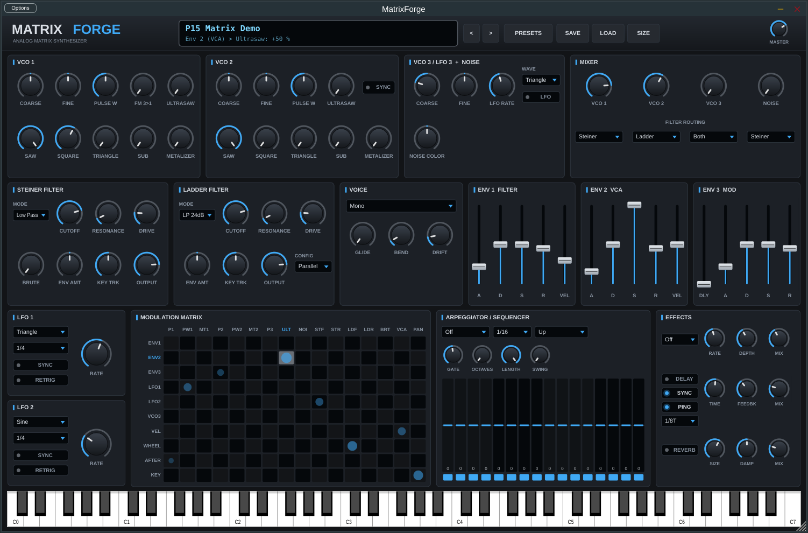

# MatrixForge

MatrixForge is a VST3 synthesizer (with a standalone app) for Windows. Its signal path and front panel follow the layout of large analog matrix monosynths such as the Arturia MatrixBrute. It is an independent, original instrument. It contains no Arturia code, artwork, samples or presets, and it is not affiliated with or endorsed by Arturia. "MatrixBrute" is a trademark of Arturia.



## Features

| Section | What it does |
|---|---|
| **VCO 1 & 2** | Saw, square and triangle at the same time, plus a sub oscillator. Ultrasaw (detuned saws), Metalizer (triangle wavefolder) and pulse width. VCO 1 has FM from VCO 3. VCO 2 can hard-sync to VCO 1. |
| **VCO 3 / LFO 3** | Sine, triangle, saw or square. It works as an audio oscillator or, with LFO on, as a free-running modulation source. |
| **Noise** | Colour control that goes from red through white to blue. |
| **Mixer** | A level for each source. Each source goes to the **Steiner** filter, the **Ladder** filter, or **Both**. |
| **Steiner filter** | Low-pass, band-pass, high-pass or notch. Drive and *Brute Factor* (output-to-input feedback growl). |
| **Ladder filter** | 4-pole transistor-ladder style: LP 24, LP 12, band-pass or high-pass. Drive. |
| **Filter config** | Parallel, or Series (Steiner into Ladder). |
| **Envelopes** | Env 1 for the filters, Env 2 for the VCA, and Env 3 for modulation (DADSR). Analog-style exponential curves. Faders. |
| **LFO 1 & 2** | 7 waveforms, including S&H and smooth random. Tempo sync and key retrigger. |
| **Modulation matrix** | 10 sources × 16 destinations, each a bipolar amount (160 routes). |
| **Arp / Sequencer** | Arpeggiator: Up, Down, Up/Down, Random or As Played, over 1–4 octaves. 16-step transposing sequencer with gates, length and swing. Both follow the host tempo. |
| **Voices** | Mono, Legato, Para 3 or Poly 8. Glide, bend range and analog drift. |
| **Effects** | Chorus or flanger, then a stereo/ping-pong delay (free or synced), then a reverb. |
| **Presets** | **256 factory presets** in 16 banks (A–P): Bass, Lead, Pad, Keys, Brass, Strings, Pluck, Arp, Sequence, Sync, Ultrasaw, Metalizer, Drone, Percussion, FX and Templates. The host sees them as programs. You can save and load your own presets (`Documents\MatrixForge\Presets\*.mfpreset`). |
| **Resizable UI** | Drag the corner, or use **SIZE** (50 %–200 %). The aspect ratio stays fixed and everything is vector-drawn, so it stays sharp on high-DPI screens. The size you pick is remembered for each project. |

### Using the panel

- **Knobs and faders:** drag to change. The display shows the parameter name and value. Double-click to reset.
- **Matrix:** drag a cell up or down. Hold **Shift** for fine control. Double-click to clear it. Blue means positive, orange means negative.
- **Sequencer:** drag a lane to set its transpose. Click the strip under a lane to switch that step's gate. Hold a key to play the sequence from that note.
- The on-screen keyboard plays the synth, which helps when you use the standalone app without a MIDI controller.
- MIDI: mod wheel (CC1), aftertouch, pitch bend and sustain pedal (CC64) all work.

## Getting the Windows build

### Option A: download from GitHub Actions (no tools needed)

Every push runs the **MatrixForge Windows build** workflow on a Windows runner. Open the repository's **Actions** tab, pick the latest run and download the **MatrixForge-Windows-x64** artifact. It contains:

- `MatrixForge.vst3`: copy this folder to `C:\Program Files\Common Files\VST3\`, then rescan plug-ins in your DAW.
- `MatrixForge.exe`: the standalone version. Set your audio and MIDI devices under *Options*.

### Option B: build it yourself on Windows 11

1. Install **Visual Studio 2022** (Community is fine) with the *Desktop development with C++* workload. It includes CMake.
2. Install **Git**.
3. In a *Developer PowerShell for VS 2022*:

```powershell
git clone <this repo>
cd <repo>\MatrixForge
cmake -B build -G "Visual Studio 17 2022" -A x64
cmake --build build --config Release
```

The plug-in will be in `build\MatrixForge_artefacts\Release\VST3\MatrixForge.vst3`. To have the build copy it into the system VST3 folder for you, configure with `-DMF_COPY_AFTER_BUILD=ON` from an administrator prompt.

CMake downloads JUCE 8.0.4 on its own the first time. The first build takes about 5–10 minutes.

## Tests

`MatrixForgeTests` renders every factory preset offline. It checks that the audio is finite, audible and not clipping. It also tests odd block sizes and sample rates, saving and restoring plug-in state, and saving and loading user presets.

```
build\MatrixForgeTests_artefacts\Release\MatrixForgeTests.exe
```

## Licence note

MatrixForge is built on the JUCE framework. JUCE is dual-licensed: AGPLv3, or a commercial JUCE licence. Building and using the plug-in yourself is fine. If you want to distribute or sell it, check the JUCE licence terms first.
