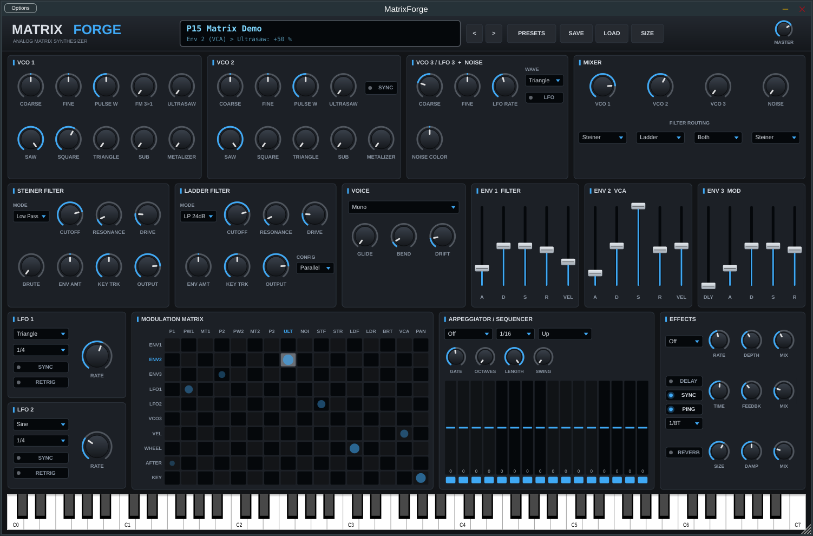

# MatrixForge

MatrixForge is a VST3 synthesizer (with a standalone app) for Windows. Its signal path and front panel follow the layout of large analog matrix monosynths such as the Arturia MatrixBrute. It is an independent, original instrument. It contains no Arturia code, artwork, samples or presets, and it is not affiliated with or endorsed by Arturia. "MatrixBrute" is a trademark of Arturia.



## Features

| Section | What it does |
|---|---|
| **VCO 1 & 2** | Saw, square and triangle at the same time, plus a sub oscillator. Ultrasaw (detuned saws), Metalizer (triangle wavefolder) and pulse width. VCO 1 has FM from VCO 3. VCO 2 can hard-sync to VCO 1. |
| **VCO 3 / LFO 3** | Sine, triangle, saw or square. It works as an audio oscillator or, with LFO on, as a free-running modulation source. |
| **Noise** | Colour control that goes from red through white to blue. |
| **Mixer** | A level for each source. Each source goes to the **Steiner** filter, the **Ladder** filter, or **Both**. |
| **Steiner filter** | Low-pass, band-pass, high-pass or notch. Drive and *Brute Factor* (output-to-input feedback growl). |
| **Ladder filter** | 4-pole transistor-ladder style: LP 24, LP 12, band-pass or high-pass. Drive. |
| **Filter config** | Parallel, or Series (Steiner into Ladder). |
| **Envelopes** | Env 1 for the filters, Env 2 for the VCA, and Env 3 for modulation (DADSR). Analog-style exponential curves. Faders. |
| **LFO 1 & 2** | 7 waveforms, including S&H and smooth random. Tempo sync and key retrigger. |
| **Modulation matrix** | 10 sources × 16 destinations, each a bipolar amount (160 routes). Destinations are grouped by section and include **Both Filter Cutoffs**. Pitch routes use a curve, so small amounts give vibrato and the full amount gives ±4 octaves. |
| **Arp / Sequencer** | Arpeggiator: Up, Down, Up/Down, Random or As Played, over 1–4 octaves. 16-step transposing sequencer with gates, length and swing. Both follow the host tempo. |
| **Voices** | Mono, Legato, Para 3 or Poly 8. Glide, bend range and analog drift. |
| **Effects** | Chorus or flanger, then a stereo/ping-pong delay (free or synced), then a reverb. |
| **Presets** | **256 factory presets** in 16 banks (A–P). Almost every preset uses the matrix for movement and gives the mod wheel and aftertouch a job. Banks:: Bass, Lead, Pad, Keys, Brass, Strings, Pluck, Arp, Sequence, Sync, Ultrasaw, Metalizer, Drone, Percussion, FX and Templates. The host sees them as programs. You can save and load your own presets (`Documents\MatrixForge\Presets\*.mfpreset`). |
| **Resizable UI** | Drag the corner, or use **SIZE** (50 %–200 %). The aspect ratio stays fixed and everything is vector-drawn, so it stays sharp on high-DPI screens. The size you pick is remembered for each project. |

### Using the panel

- **Knobs and faders:** drag to change. The display shows the parameter name and value. Double-click to reset.
- **Matrix:** drag a cell up or down. Hold **Shift** for fine control. Double-click to clear it. Right-click for preset amounts and for clearing a row, a column or the whole matrix. Blue means positive, orange means negative.
  - The display shows each route in real units, such as `+7.0 st` or `+1.50 oct`.
  - Each source name has a live meter, and a cell glows while it is moving the sound.
  - If a route can't be heard with the current patch, an orange note under the grid says why. For example, pulse width does nothing while that oscillator's square level is 0.
  - Wheel and aftertouch rows only act when you move the wheel or press the keys harder.
- **Sequencer:** drag a lane to set its transpose. Click the strip under a lane to switch that step's gate. Hold a key to play the sequence from that note.
- The on-screen keyboard plays the synth, which helps when you use the standalone app without a MIDI controller.
- MIDI: mod wheel (CC1), aftertouch, pitch bend and sustain pedal (CC64) all work.

## Getting the Windows build

### Option A: one-click installer (recommended)

Download **MatrixForge-Setup.exe** from the repository's **Releases** page (release *matrixforge-latest*) and run it. It:

- installs the VST3 plug-in into `C:\Program Files\Common Files\VST3\`, where every Windows DAW looks;
- installs the standalone app into `C:\Program Files\MatrixForge` and adds it to the Start menu, with an optional desktop shortcut;
- registers an uninstaller under *Settings → Apps*.

Close your DAW before installing, then rescan plug-ins if the DAW doesn't pick it up on its own. Running a newer installer upgrades the existing installation. Your saved presets in `Documents\MatrixForge` are never touched.

The installer isn't code-signed, so Windows SmartScreen may warn you the first time. Click **More info → Run anyway**.

Every push to the branch rebuilds the installer and replaces that release. The same file is also attached to each run on the **Actions** tab as the **MatrixForge-Setup** artifact.

### Option B: loose files from GitHub Actions

The **MatrixForge-Windows-x64** artifact on each Actions run has the raw files: copy `MatrixForge.vst3` to `C:\Program Files\Common Files\VST3\`. `MatrixForge.exe` is the standalone app.

To build the installer yourself after Option C, install [Inno Setup 6](https://jrsoftware.org/isinfo.php) and run `iscc /DAppVersion=1.1.0 installer\MatrixForge.iss`. The installer is written to `dist\MatrixForge-Setup.exe`.

### Option C: build it yourself on Windows 11

1. Install **Visual Studio 2022 or newer** (Community is fine) with the *Desktop development with C++* workload. It includes CMake.
2. Install **Git**.
3. In a *Developer PowerShell for VS*:

```powershell
git clone <this repo>
cd <repo>\MatrixForge
cmake -B build -A x64
cmake --build build --config Release
```

The plug-in will be in `build\MatrixForge_artefacts\Release\VST3\MatrixForge.vst3`. To have the build copy it into the system VST3 folder for you, configure with `-DMF_COPY_AFTER_BUILD=ON` from an administrator prompt.

CMake downloads JUCE 8.0.4 on its own the first time. The first build takes about 5–10 minutes.

## Tests

`MatrixForgeTests` renders every factory preset offline. It checks that the audio is finite, audible and not clipping. It also tests odd block sizes and sample rates, saving and restoring plug-in state, and saving and loading user presets. `MatrixForgeTests --features` prints a CSV fingerprint for each preset: brightness, timbre and level movement, envelope shape, stereo width, noisiness and pitch movement. It's used to check that the presets in a bank really differ from each other.

```
build\MatrixForgeTests_artefacts\Release\MatrixForgeTests.exe
```

## Licence note

MatrixForge is built on the JUCE framework. JUCE is dual-licensed: AGPLv3, or a commercial JUCE licence. Building and using the plug-in yourself is fine. If you want to distribute or sell it, check the JUCE licence terms first.
